<picture>
  <source media="(prefers-color-scheme: dark)" srcset="assets/hero-dark.svg">
  
</picture>

I lead technical programs for platform and AI infrastructure, and I like owning the whole arc: discovery, roadmap, delivery, and the numbers afterward.

## What I do as a TPM

**Agentic AI platform, from zero to production.** I was the program lead for an agent platform in the platform engineering org behind HBO Max, Discovery+, TNT Sports, and CNN. 79+ agents are live in production. Technical and non-technical teams get their agents and apps deployed and operated there, with evals, versioned prompts, rollback, cost tracking, and governed access to tools and data.

**Cloud cost, down 43% in a year.** I led decommissioning across a large AWS footprint with no customer impact, through peak streaming events.

**Delivery and reliability.** Deployments went from three days to under four hours with one-click rollbacks. Support tickets fell by more than a quarter, and SLO compliance went up.

## How I run programs

<picture>
  <source media="(prefers-color-scheme: dark)" srcset="assets/program-dark.svg">
  
</picture>

- A named owner for every workstream, and a date.
- Evidence before launch: evals, not opinions.
- Every launch can be undone in one step.
- Deterministic where it works. AI where it earns its place. Measure both.

## Tools I build for TPMs

Personal projects, built in my own time. Not my employer's work.

**[agent-skills](https://github.com/amir-sohel-builds/agent-skills)**: 17 TPM tools that run, not advice. Every skill ships a script, a worked example, and an eval.

**[jobfunnel](https://github.com/amir-sohel-builds/jobfunnel)**: a deterministic job-search tracker with transparent, rule-based scoring. No scraping, and no LLM in the core loop.

[Portfolio](https://amir-sohel-builds.github.io) | [LinkedIn](https://www.linkedin.com/in/asohel) | [Email](mailto:aot.amirsohel@gmail.com)
